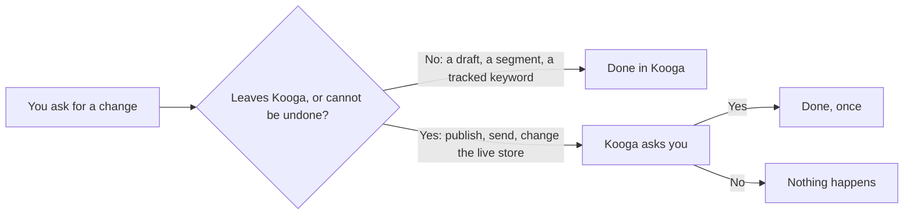

<p align="center">
  <a href="https://kooga.io">
    <picture>
      <source media="(prefers-color-scheme: dark)" srcset="skills/kooga-mcp/assets/kooga-wordmark-dark.svg">
      <source media="(prefers-color-scheme: light)" srcset="skills/kooga-mcp/assets/kooga-wordmark-light.svg">
      
    </picture>
  </a>
</p>

<p align="center"><strong>Your business's marketing, in your AI assistant.</strong></p>

<p align="center">
  <a href="https://kooga.io/docs/integrations/connect-an-assistant">Documentation</a> ·
  <a href="https://kooga.io/docs/integrations/mcp-tools">Every tool</a> ·
  <a href="https://kooga.io/pricing">Pricing</a> ·
  <a href="https://kooga.io/privacy-policy">Privacy</a>
</p>

<p align="center">
  <a href="https://cursor.com/install-mcp?name=Kooga&config=eyJ1cmwiOiJodHRwczovL21jcC5rb29nYS5pby9tY3AifQ%3D%3D"></a>
  <a href="https://vscode.dev/redirect/mcp/install?name=kooga&config=%7B%22type%22%3A%22http%22%2C%22url%22%3A%22https%3A%2F%2Fmcp.kooga.io%2Fmcp%22%7D"></a>
  <a href="https://glama.ai/mcp/connectors/io.kooga.mcp/kooga"></a>
</p>

Ask how your sales, Google rankings, AI visibility and email moved, and have Kooga write articles, draft campaigns and answer what its agents left for you. Anything that leaves Kooga asks you first. The **Kooga** plugin bundles the hosted MCP connection and a workflow skill that teaches your assistant to use it well.

| | |
|---|---|
| Server | `https://mcp.kooga.io/mcp`, Streamable HTTP |
| Sign-in | OAuth 2.1 (dynamic client registration, PKCE), or an access token |
| Registry name | `io.kooga/kooga` |

## Works with

| | Service | What Kooga does there |
| --- | --- | --- |
|  | Shopify | Reads orders, products, customers and product listings; publishes articles to the store's blog |
|  | WordPress and WooCommerce | Reads WooCommerce orders and products; publishes articles to the site |
|  | Google Search Console | Reads clicks, impressions and queries: pages just off page one, articles losing traffic |
| <picture><source media="(prefers-color-scheme: dark)" srcset="https://kooga.io/images/logos/ChatGPT-logo-white.svg"></picture>    | ChatGPT, Claude, Gemini, Perplexity and Google's AI Overviews | Asks them the questions your buyers ask, and tracks how often they name you, who they name instead and what they cite |

Email goes out from Kooga itself, from your own verified domain.

## Install the plugin

### Claude Code

```text
/plugin marketplace add HushThrive/kooga-mcp
/plugin install kooga@kooga
```

Start a new session and use `/mcp` to sign in to Kooga. Ask about your business, or invoke `/kooga:kooga-mcp`. [Claude Code plugin documentation](https://code.claude.com/docs/en/discover-plugins)

### Codex

```bash
codex plugin marketplace add HushThrive/kooga-mcp
codex plugin add kooga@kooga
```

Start a new session and sign in to Kooga when asked. Pick Kooga from `/skills` or the `$` picker, or ask what is waiting for you. [Codex plugin documentation](https://developers.openai.com/codex/plugins/build)

### Cursor

1. Open **Settings → Plugins**.
2. Paste `https://github.com/HushThrive/kooga-mcp` into the plugin search box.
3. Install **Kooga**, then connect its MCP server and sign in when asked.

Or use the **Add to Cursor** button above for the connection alone.

### VS Code and GitHub Copilot

1. Turn on **`chat.plugins.enabled`** in settings.
2. Run **Chat: Install Plugin From Source** from the Command Palette.
3. Enter `https://github.com/HushThrive/kooga-mcp` and install **Kooga**.
4. Start a new chat and sign in to Kooga when asked.

Or use the **Install in VS Code** button above, or `code --add-mcp '{"name":"kooga","type":"http","url":"https://mcp.kooga.io/mcp"}'`, for the connection alone.

### Claude and ChatGPT

- **Claude** (web and desktop): **Settings → Connectors → Add custom connector**, name it Kooga, paste `https://mcp.kooga.io/mcp`, then **Connect**.
- **ChatGPT**: turn on developer mode (paid plans; on Business or Enterprise your admin allows it), then add a connector with the address `https://mcp.kooga.io/mcp` and OAuth as its sign-in.

### Any other assistant

Add a remote MCP server with the address `https://mcp.kooga.io/mcp` over **Streamable HTTP**. Kooga runs the server: there is nothing to install or run on your side. To try it in MCP Inspector, run `npx @modelcontextprotocol/inspector`.

If your assistant supports standalone skills, you can add the workflow guidance on its own:

```bash
npx skills add HushThrive/kooga-mcp --skill kooga-mcp
```

That installs instructions only; add the connection separately. Choose the plugin or the standalone skill, not both, to avoid duplicate guidance.

## Connect your account

You need a Kooga account, as owner or admin of the workspaces you connect.

1. Your assistant opens Kooga's sign-in when it first meets the server.
2. Tick the workspaces it may reach, choose **Read only** or **Read and change**, then **Allow**.
3. Ask which workspaces it reaches. One connection can reach several, which suits agencies.

For n8n, Make, scripts or any client that cannot open a sign-in page, make an access token in Kooga at **Settings → Connected apps → Access tokens**. It starts with `kooga_pat_`, is shown once, and goes in the bearer header:

```bash
claude mcp add --transport http kooga https://mcp.kooga.io/mcp --header "Authorization: Bearer kooga_pat_..."
```

A token works as you, in the workspaces you ticked, with the same confirmations and limits. Keep it in your client's credential settings and treat it like a password. Every connection is listed, and can be disconnected, at **Settings → Connected apps**.

## Try it

- "What is waiting for me in Kooga?"
- "What changed in my store this week?"
- "Which articles are losing traffic, and which should I refresh first?"
- "How often do AI answers mention us next to our competitors?"
- "Draft an abandoned-cart flow: a reminder after an hour, then one more the next day."
- "Compare March with February: orders, email results and AI visibility."

## Tools

| Area | Reads | Changes |
| --- | --- | --- |
| The connection | `readConnection`, `listWorkspaces` | |
| Your agents | `readWaitingItems`, `readRecentRuns`, `readStatus` | `approveItem`, `dismissItem`, `undoAction` |
| Store | `readStoreOverview`, `readTopProducts`, `readProducts`, `readSalesTrend`, `readSalesChannels`, `readCustomerStats` | `updateListing` |
| Google search | `readOpportunities`, `readDecaying`, `readRankings`, `readBacklinks`, `readSiteHealth`, `researchKeywords`, `readListings`, `readIdeas` | `generateArticle`, `refreshArticle`, `publishArticle`, `trackKeyword` |
| AI visibility | `readScorecard`, `readTopics`, `readCompetitors`, `readSources`, `readPerceptions`, `readAnswers`, `readShelf` | `addPrompt`, `addCompetitor`, `briefContentGap`, `proposeProbe` |
| Email | `readPerformance`, `readDeliverability`, `readCampaigns`, `readCampaign`, `readFlows`, `readSegments`, `previewSend`, `findContacts`, `readContact` | `draftCampaign`, `updateCampaign`, `scheduleCampaign`, `sendTestCampaign`, `resendCampaign`, `deleteCampaign`, `draftFlow`, `updateFlowStep`, `enableFlow`, `createSegment`, `updateContact`, `unsubscribeContacts`, `uploadImage`, `updateEmailBrand` |
| Knowledge | `searchDocuments`, `readDocument`, `listDocuments`, `readOptions` | |
| Store chat, once you turn it on | `readCustomerInbox`, `readCustomerFeedback` | |

The connected server's tool list is authoritative: a read-only connection gets the reads only, and the tools that read what shoppers wrote to your store's chat appear only once you turn them on. Each tool, with what it takes and returns, is in the [tool reference](skills/kooga-mcp/references/tools.md) and on [kooga.io](https://kooga.io/docs/integrations/mcp-tools).

The server also offers four ready-made prompts (**Account audit**, **Monday review**, **Fix my weakest topic**, **Competitor radar**) and a glossary of Kooga's terms as the resource `kooga://glossary`.

## What asks before doing

Work that stays inside Kooga runs at once, as if you did it in Kooga. Anything that leaves Kooga, or cannot be taken back, asks you first, in Kooga's own words.



Where your assistant can show the question, it does; otherwise it asks you in the chat. One yes does one thing. A change that replaced something, such as a product listing or a published article, can be undone while nothing has changed it since; a sent email cannot. Kooga moves no money, changes no plan and never subscribes anyone.

## Troubleshooting

| Symptom | Next step |
| --- | --- |
| Asked to sign in again | Your session ended or the app was disconnected. Connect again from the assistant |
| "This connection has read-only access" | Connect again and choose **Read and change** |
| "This connection reaches several workspaces" | Name the workspace you mean; the assistant can list them |
| A new tool or prompt is missing | Refresh the connector's tools in your assistant, or reconnect it |
| "This workspace has no store connected" | Connect Shopify or WooCommerce at **Settings → Integrations** |
| "Customer messages are off for this connection" | An owner or admin turns them on at **Settings → Connected apps** |
| "The most it allows in a day" | The daily limit for assistants is reached. Do the rest in Kooga, wait, or raise it at **Settings → Connected apps** |
| "Too many requests" | Wait a minute, or ask for several things in one question |

## Privacy

- **What reaches your assistant**: what it looks up for you (your store's figures, articles, contacts and, only if you turn them on, what shoppers wrote to your store's chat) goes to the company that runs the assistant, under that company's terms.
- **What Kooga keeps**: a record of each request (who asked, which app, which workspace, which tool, whether it worked), never what was sent or came back. You see it at **Settings → Connected apps**; each entry is deleted after 180 days.
- **Who can reach what**: the assistant signs in with a token issued for your account and never sees your password. Anyone who loses access to a workspace loses their assistant's access to it at the same moment.
- **Text from outside**: what shoppers, other sites and AI engines wrote reaches the assistant marked as information, never as instructions.

The full policy is at [kooga.io/privacy-policy](https://kooga.io/privacy-policy).

## This repository

Kooga hosts the server, so this repository holds no server code. It holds what assistants and directories need to install and list it:

| File | What it is |
| --- | --- |
| `plugin.json`, `mcp.json` | The portable plugin and its MCP connection (`streamable-http`) |
| `.mcp.json` | The same connection in the native format (`http`) |
| `.claude-plugin/`, `.codex-plugin/`, `.cursor-plugin/` | Each assistant's own manifest; `.claude-plugin/marketplace.json` and `.agents/plugins/marketplace.json` make this repository its own marketplace |
| `skills/kooga-mcp/` | The workflow skill, its tool reference and Kooga's logos |
| `server.json` | The [MCP Registry](https://registry.modelcontextprotocol.io) entry, `io.kooga/kooga`, published by `.github/workflows/publish.yaml` when it changes |
| `lhm.plugin.json` | The LobeHub listing |

## Help

- Setup and use: [Kooga documentation](https://kooga.io/docs/integrations/connect-an-assistant)
- Your account or a connection: [support@kooga.io](mailto:support@kooga.io)
- Wrong instructions or metadata here: [open an issue](https://github.com/HushThrive/kooga-mcp/issues), without tokens or customer data
- Vulnerabilities or an exposed token: see [SECURITY.md](SECURITY.md)

The files in this repository are under the [MIT licence](LICENSE). Kooga itself is a hosted service under its [terms](https://kooga.io/terms-of-service).
